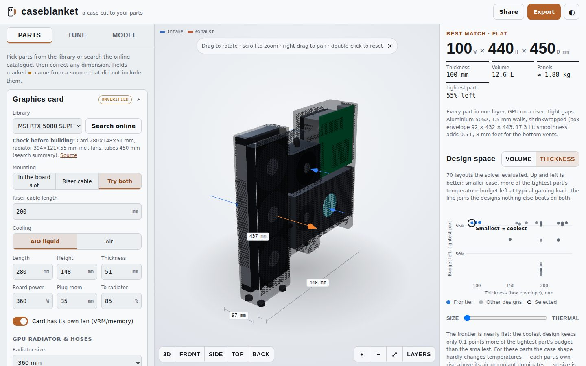

# caseblanket

Design a PC case cut to your exact parts. Pick a motherboard, CPU cooler, PSU and graphics card (AIO liquid-cooled cards are the main case), set how much you care about airflow, thinness and total volume, and caseblanket searches layouts for the smallest case that still breathes. It shows the result in a 3D view you can rotate, pinch and pan on a phone.




## What it does

- **Parts in, case out.** Built-in library (form-factor standards plus a handful of AIO GPUs and coolers), a search of an online parts catalogue, an optional Claude-assisted spec lookup, or your own numbers. Every part shows where its numbers came from.
- **Straight box or tight shrinkwrap.** *Shell* picks a straight box or a shell pulled tight around the parts, their air gaps, the routed AIO hoses and the GPU power cable. *Smoothness* goes from tight with straight faces to smooth, bridging gaps between parts up to 30–130 mm (a morphological closing computed with a 3D distance transform) and rounding the edges; the results say how many litres the smoothing adds. The GPU's power connector gets a local plug box, not a strip along the whole card. A surface-nets mesher turns it into the rendered shell, with perforations drawn by a shader. Every part body, clearance, hose and cable stays at least one wall inside, and 5–6 % of the inside is anything else when tight (18–24 % when smooth).
- **Design-space explorer.** Every valid layout the solver evaluates is plotted as size (volume or thickness) against how much of the tightest part's temperature budget is left. The frontier (designs nothing beats on both) is highlighted with its smallest and coolest ends; click or tap any point to load it, slide along the frontier, or read it as a table. *Check ends and selection in 3D* runs short 3D simulations of those designs and plots them beside the model's numbers.
- **Every part against its own limit.** CPU, GPU core, GPU memory/VRM, PSU intake air and the case air around the board each get a temperature: room + the air (or coolant) around it + its own rise (power × an estimated thermal resistance), at *typical gaming* (CPU 50 %, GPU 90 % of rated power) or *sustained full* load. Limits, resistances and loads are editable estimates in the Model tab.
- **Internal chambers.** The airflow model is a network of air zones. For every layout the solver tries each printed partition that fits between the parts (2 or 3 chambers, with leaky pass-throughs for hoses, cables and the riser) and keeps one only when it lifts the tightest part by more than 5 % of its budget. Walls are drawn in copper, trimmed to the shell and exported as printable pieces. With an air-cooled card and a tower cooler, a wall between the card and the board/PSU frees 20 % of the PSU intake's budget in the model.
- **3D airflow simulation.** *Simulate airflow* runs an incompressible flow and heat simulation of the case and the room air around it (staggered grid, ~1 cm cells, fans as pressure jumps on their rated curves with swirl, porous radiators, fins, PSU and panels, partitions, buoyancy) in a worker. On calibration ducts it matches the fan-curve model within 2 % and changes by 0.3 % on a grid twice as fine. The 3D view animates thousands of tracer streaks coloured from room temperature to hot, with an optional temperature slice. See [docs/airflow-sim-brief.md](docs/airflow-sim-brief.md).
- **Shape the airflow.** An optimiser tries exhaust deflectors (louvres throwing hot plumes away from intakes), intake ducts (sealing a fan to its vent), radiator fan reversals and partitions, and keeps a change only when the simulation lifts the tightest part by more than 3 % of its budget; walls that do nothing in 3D are dropped. Kept changes are drawn in copper. In the test case of an exhaust beside an intake, a deflector cuts the re-ingested heat from +8.3 °C to +2.8 °C.
- **3D-printable pieces.** Export → *3D-printable pieces* turns the shell (box or organic) into solid walls with the vent holes and I/O cut-outs cut through, splits it on straight planes to fit your print bed, and downloads one closed STL per piece in a zip.
- **GPU mounting toggle.** Put the card straight in the motherboard's x16 slot, on a riser cable, or let the solver try both (Parts → Graphics card → Mounting).
- **Searches layouts, not just one template.** Four layout families: *flat* (everything in one layer, GPU on a riser), *sandwich* (GPU behind the board), *direct slot* (no riser), and *direct slot with parts stacked behind the board*. Within each family it tries every orientation of the PSU and radiators, every placement, and three gap sizes (plus 15 mm slim radiator fans if you allow them).
- **Airflow estimate.** Fan curves against panel, radiator and gap losses, a pressure and energy balance for every air zone, and the temperature of every part. It's a first-order estimate, not CFD.
- **Build checks.** Riser cable reach, AIO hose reach, fans that must face a vented panel, the PSU's AC inlet, your size limits.
- **Your priorities.** Sliders for airflow vs. compactness and thinness vs. volume, a minimum-airflow floor, shell type and smoothness, edge radius and rounded/chamfered style, wall material and thickness, perforation style, which panels may be vented, passive-vent coverage, radiator fan direction, slim fans, internal chambers, tower or console orientation, riser length, part clearance, max width/height/depth, room temperature and load profile. The Model tab exposes the gap sizes, loss coefficients, loads, temperature limits and thermal resistances.
- **Alternatives.** Best match, thinnest, smallest, coolest and the best of each layout family, each with its trade-off against the best match.
- **3D view.** Touch: one finger rotates, pinch zooms, two fingers pan, double-tap resets. Mouse: drag, wheel, right-drag, double-click. Preset views, see-through shell, exploded view, airflow arrows (blue in, orange/red out, redder = warmer), dimension lines, part names and clearance boxes.
- **Exports.** Hollow shell as STL, 3D-printable pieces (shell and partition walls) as a zip of STLs, flat drawings of all six panels with perforations and cut-outs as 1:1 SVG (straight box only), a PNG of the view, the full design as JSON, and a share link that carries every setting.

## Design brief

Later rounds have their own briefs: [iteration 1](docs/iteration-1-brief.md) (tight shell, part temperatures, chambers, calibrated simulation, design-space explorer) and [iteration 2](docs/iteration-2-brief.md) (noise, structures round 2, printability, independent references).

The request was to "improve this prompt before running it". The brief it was built against:

> Build **caseblanket**, a web app that designs a minimum-thickness, minimum-volume PC case around a given list of components, without giving up much airflow.
>
> **Stack:** TypeScript, Vite, React, three.js. Static site with no backend, deployable to GitHub Pages, usable on phones and tablets.
>
> **Inputs (mm, all editable):** motherboard (Mini-ITX, Thin Mini-ITX, Mini-DTX, Micro-ATX, ATX or custom outline, plus heights for RAM/I-O, underside and CPU stack); CPU cooler (low-profile, tower or AIO with radiator and hoses) and CPU power; PSU (SFX, SFX-L, Flex ATX, TFX, ATX or custom, fan position, cable room); graphics card, AIO liquid-cooled by default (card L×H×T, board power, radiator outline and fans, hose length and exit, VRM fan, power-connector bend room), air-cooled as an alternative; extra boxes such as drives.
>
> **Where dimensions come from:** a bundled library tagged by trust level (standard / unverified / estimate), a runtime search of an open parts catalogue (it holds GPU length, board and PSU form factors, AIO radiator size and CPU TDP), an optional lookup with Claude and web search using the user's own API key that must cite the pages it used, and manual entry. Fields a source could not fill are flagged.
>
> **Solver:** enumerate layout families (flat/riser, sandwich/riser, direct slot, direct slot with stacking), part orientations and placements with a beam search; enforce clearances, fans facing vented panels, rear I/O and GPU bracket on the back wall, riser and hose reach and size limits; rank by a weighted mix of thickness, volume and an airflow score.
>
> **Airflow:** fan P–Q curves against vent, radiator, fin-stack, plenum and proximity losses; a one-zone case pressure balance with passive vents; ΔT = P / (ρ·cp·Q) per heat path; label it an estimate.
>
> **Controls:** airflow vs. compactness, thinness vs. volume, minimum airflow, edge style and radius, material and wall thickness, finish, perforation style, vented panels, passive venting, radiator fan direction, slim fans, orientation, allowed layouts, riser length, clearance, max W/H/D, room temperature and allowed rise, model coefficients.
>
> **Rendering:** interactive 3D preview with touch (one-finger rotate, pinch zoom, two-finger pan, double-tap reset), mouse and buttons; see-through shell, explode, airflow arrows, dimensions, labels.
>
> **Output:** external size, thickness, volume, panel weight, per-path airflow table, build checks, ranked alternatives; STL, SVG panels, PNG, JSON, share link.
>
> **Quality:** responsive from 390 px phones to desktops, light and dark themes, unit tests for geometry, packing and airflow, an end-to-end test that drives touch gestures.

## Run it

```bash
npm install
npm run dev          # http://localhost:5173
npm test             # unit tests (geometry, packing, airflow, exports, lookups)
npm run build        # static site in dist/
npm run build:single # one self-contained file: dist-single/caseblanket.html (opens from disk)
npm run preview &    # serve dist/ on :4173, then:
npm run e2e          # renders 4 screen sizes, drives touch gestures and controls, writes e2e/out/*.png
```

`npm run e2e` uses `playwright-core` with a Chromium binary; set `CHROMIUM_PATH` if yours is not at the path in `e2e/run.mjs`.

The repo ships two GitHub Actions workflows: `ci.yml` (typecheck, unit tests, build, end-to-end) and `pages.yml` (deploy `dist/` to GitHub Pages; set **Settings → Pages → Source** to *GitHub Actions* first).

## How it works

### Solver (`src/solver`)

Solver axes: **u** runs front-to-back from the rear I/O wall (u = 0), **v** is the other in-plane axis, **t** is the stacking axis. Every part is an oriented box with clearances on specific faces (fan gaps, cable room, hose exits, riser plug), taken from its local frame. The GPU keeps its real handedness, so its PCIe fingers and cooler side end up where a physical card would put them.

A layout family defines one or two layers along t. Parts either sit in a layer or span both. `pack.ts` runs a beam search: every step places one more part at a corner point of the parts already placed (including "the same spot in the other layer", which is how sandwiches form), rejects overlaps within a layer, keeps committed fan walls from moving, prunes riser paths longer than the riser and layouts past your size limits, and keeps the best states by a log-weighted mix of thickness and volume. `evaluate.ts` turns each finished layout into a 3D design. It grows the case where a fillet would cut into a corner part, places vents, runs the airflow model and the build checks, and weighs the panels. `solve.ts` repeats this for every layout family and gap profile, then ranks and deduplicates the designs.

The default build solves 20 runs and evaluates 200 layouts in about a second, in a Web Worker.

### Airflow model (`src/solver/airflow.ts`, `src/solver/chambers.ts`)

- Fans: a straight line from rated free airflow to max static pressure. Groups of fans add airflow.
- Losses: ζ·½ρv² terms for the perforated panel (Idelchik's thin perforated plate, ζ = (0.707·(1−φ)^0.375 + 1 − φ)² / φ²), the radiator core (scaled by core thickness), air-cooler fins, PSU internals, dust filters, a fan-to-panel proximity term and the plenum behind radiators that blow into or out of the case.
- The case is a network of air zones (one, unless partitions split it). Each zone has its own pressure, passive vents and seam leakage; zones exchange air through the partitions' pass-throughs and joints. Pressures come from mass balance (Newton), zone temperatures from energy balance (a linear system).
- Each heat path warms its air by ΔT = P / (ρ·cp·Q) over the air it drew. Each part's temperature is room + that air (mean across its fins, its coolant at the radiator's effectiveness, its intake air for the PSU, or its zone's air) + its own rise, power × thermal resistance. The design is rated on the share of each part's budget (limit − room) left; the score weights each part by its heat.

Treat it as a ranking tool. Real fan curves bend, air leaks and short-circuits between vents, and radiator performance depends on more than airflow. Prototype anything with less than about a third of its budget left before cutting metal.

### Trust levels of the numbers

| Badge | Meaning |
|---|---|
| Standard | A form-factor standard (board outlines, SFX/SFX-L/Flex ATX/TFX/ATX PSU outlines). |
| Unverified | Manufacturer figures read from web-search summaries of the linked spec pages. The manufacturer sites were blocked from the environment this was built in, so the pages themselves were not opened. **Check before building.** |
| Estimate | Typical values chosen by caseblanket: generic radiators, fans, board heights, socket and slot positions, PSU fans, loss coefficients. |
| Catalogue | From [docyx/pc-part-dataset](https://github.com/docyx/pc-part-dataset) (MIT; PCPartPicker listings, July 2025), fetched at runtime from raw.githubusercontent.com. |
| Your values | Anything you typed in. |

### Claude lookup (optional)

In the catalogue dialog, *Look it up with Claude* sends the part name to Claude Opus 5.5 with web search, using your own Anthropic API key. The call goes from your browser straight to `api.anthropic.com`, and the key is stored in `localStorage` only if you tick *Remember*. The reply must be JSON with the pages the numbers came from. caseblanket drops values outside physical ranges and cited pages the search never returned. Everything else is marked *unverified* and fields left empty are flagged. The request opts into the API's server-side refusal fallback (`fallbacks: "default"`), so a request declined by a safety classifier is retried on Anthropic's recommended fallback model. Each lookup is billed to your key.

## Known limits

- The one-piece STL is the shell surface without vents; the 3D-printable pieces have the vents and cut-outs. Neither includes standoffs, screw bosses or fan mounting holes.
- The airflow simulation is coarse (~1 cm cells): it doesn't resolve blades, fin passages, boundary layers or turbulence, so bell-mouth inlets, diffusers, turning vanes and vortex generators are listed, not evaluated. Its calibration is against the app's own fan-curve model; independent references come in iteration 2 ([docs/iteration-2-brief.md](docs/iteration-2-brief.md)).
- Temperature limits, thermal resistances and load shares are typical values, not your parts' datasheets.
- For the default parts the design-space frontier is nearly flat: case geometry moves the tightest part by under a point of its budget, because each part's own rise above its air dominates. Fan speed, the bigger lever, is iteration 2.
- The explorer plots box-envelope sizes; the selected design's shrinkwrapped size is in its summary.
- The solver reserves the GPU connector's bend room along the whole card edge when packing; only the shell uses the local plug box.
- The direct-slot card position, socket and x16-slot locations and the riser path are typical values, not taken from your specific board.
- Cables are modelled as clearance boxes (PSU cable face, GPU power connector, hoses), not routed.
- Built-in AIO GPU entries are few and unverified. For anything else, use the catalogue, the Claude lookup or the spec sheet.
