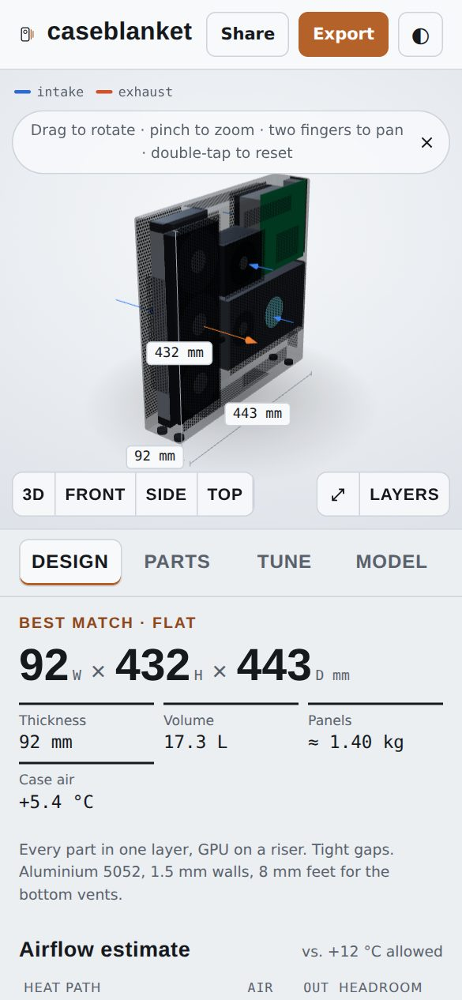

# caseblanket

Design a PC case cut to your exact parts. Pick a motherboard, CPU cooler, PSU and graphics card (AIO liquid-cooled cards are the main case), set how much you care about airflow, thinness and total volume, and caseblanket searches layouts for the smallest case that still breathes. It shows the result in a 3D view you can rotate, pinch and pan on a phone.




## What it does

- **Parts in, case out.** Built-in library (form-factor standards plus a handful of AIO GPUs and coolers), a search of an online parts catalogue, an optional Claude-assisted spec lookup, or your own numbers. Every part shows where its numbers came from.
- **Straight box or tight shrinkwrap.** *Shell* picks a straight box or a shell pulled tight around the parts, their air gaps, the routed AIO hoses and the GPU power cable. *Smoothness* goes from tight with straight faces to smooth, bridging gaps between parts up to 30–130 mm (a morphological closing computed with a 3D distance transform) and rounding the edges; the results say how many litres the smoothing adds. The GPU's power connector gets a local plug box, not a strip along the whole card. A surface-nets mesher turns it into the rendered shell, with perforations drawn by a shader. Every part body, clearance, hose and cable stays at least one wall inside, and 5–6 % of the inside is anything else when tight (18–24 % when smooth).
- **Shrinkwrap mode.** Tune → *Shrinkwrap mode* moulds the shell along every part, its air gaps, the hoses and the GPU power cable, with no dead space: no smoothing (only slits under 12 mm between parts are closed, which could not be printed or cleaned), a flat I/O plate behind each rear part only, and no wedge behind a tilted radiator or case fan: the skin runs along the tilted fans at their wall gap and is vented there, so the airflow model charges no turn and no wider gap. Layouts are still chosen by your priorities, with size measured on the moulded shell (a quick voxel estimate for every layout, the meshed shell for the shortlist). Every summary reports the shell's dead space: air inside it that no part, air gap, hose or cable needs. Measured on the default parts' best layout: straight box 7.4 L dead, faceted 7.7 L, pebble 11.6 L, shrinkwrap 2.7 L (1.6 L tight), shrinkwrap mode 1.4 L; on a layout with a GPU radiator tilted 30°: box 20.6 L, shrinkwrap 7.9 L (7.2 L tight, most of it the wedge), shrinkwrap mode 2.1 L. What is left is mostly the 2–3 mm meshing margin kept around every part. Without the wedge's wider gap, tilting gains nothing thermally in this mode, so the solver rarely picks a tilted layout.
- **Design-space explorer.** Every valid layout the solver evaluates is plotted as size (volume or thickness) against how much of the tightest part's temperature budget is left. The frontier (designs nothing beats on both) is highlighted with its smallest and coolest ends; click or tap any point to load it, slide along the frontier, or read it as a table. Designs are compared at the noise budget (those that can't meet it are drawn hollow); *Noise needed* plots the quietest noise at which every part stays under its limit instead. *Check ends and selection in 3D* runs short 3D simulations of those designs and plots them beside the model's numbers.
- **Noise as a constraint.** Each fan runs at a solved speed: *coolest within a noise budget* (default 30 dB(A) at 1 m) or *quietest with every part under its limit*. Noise comes from each fan's rating and the fan laws (airflow ∝ speed, pressure ∝ speed², sound power +50·log₁₀ of the speed ratio), grille penalties and tones at the blade-pass frequency, vent noise, AIO pumps and a semi-passive PSU, added as powers. Designs that can't meet the budget say so. All acoustic numbers are estimates.
- **Every part against its own limit.** CPU, GPU core, GPU memory/VRM, PSU intake air and the case air around the board each get a temperature: room + the air (or coolant) around it + its own rise (power × an estimated thermal resistance), at *typical gaming* (CPU 50 %, GPU 90 % of rated power) or *sustained full* load. Limits, resistances and loads are editable estimates in the Model tab.
- **Internal chambers.** The airflow model is a network of air zones. For every layout the solver tries each printed partition that fits between the parts (2 or 3 chambers, with leaky pass-throughs for hoses, cables and the riser) and keeps one only when it lifts the tightest part by more than 5 % of its budget. Walls are drawn in copper, trimmed to the shell and exported as printable pieces. Once fan speeds follow the noise budget and the PSU is semi-passive, walls rarely pay: in the built-in library they win only for a tower CPU cooler with the AIO card at full load.
- **Flow tab.** Switches for every structure that shapes the air: multi-chamber, ducts (plates closing each fan's gap to its vent), bell-mouth inlets and exit diffusers (a rounded lip or a 6° cone in a fan's gap), rounded vent holes (the entry edge of every hole chamfered, so the air does not contract through it), radiused turns (a curved fairing in each tilt frame), deeper plenums (20 mm more behind radiators and case fans), exhaust deflectors, tilted parts, case fans and the radiator direction. A structure switched on is part of the design: the airflow model rates it, the 3D simulation has it where it is big enough for the grid (ducts, deflectors, the vents' loss), and the printed pieces have it (fused to the panels, clipped to the inside of the shell); deflectors are in the 3D simulation only and not printed yet. Switched off, each shows what it would do for the selected design, on the tightest part and on the part that gains most. The coefficients are textbook-style values written from memory (listed in `src/solver/flow.ts`), not checked against a source opened here. With the default parts each changes any part by 0.2 K or less: the radiators' cores and the fin stacks dominate the losses, the fans run under the noise budget, and the fan gaps are 1–6 mm, too small for much of a lip or a cone. They matter more in layouts with room around the fans.
- **Exploring the structures.** The explorer can overlay the frontier with every flow structure on (or off, when they are on), from a second solve of the same parts.
- **Funkify.** Organic, sculpted designs that give up nothing on cooling, with size ignored: a cooling-only search with every flow structure on, curved shells (pebbles, leaning stones, smooth shrinkwraps, a faceted wedge) on every layout within 3 % of the coolest, a look score, and a 3D check of the best against the coolest layout in a straight box (kept within 1 K). The look score is a stated heuristic: share of the surface that curves (35 %), roundness against the same layout in a box (25 %), calm against its convex hull (20 %), proportions against φ (20 %). Finishes and perforation styles are dealt out for variety. About 40 s, in a worker.
- **Angled and curved panels.** Tune → Shell: besides the straight box and the shrinkwrap, *Faceted* (flat panels at angles: bevelled edges and corners, as deep as the parts allow) and *Pebble* (curved panels rounding into each other, with elliptical fillets kept in proportion on a slim case). A *front lean* turns the front into a wedge: it leans back, held tight to the parts at the top, and the base comes forward. Every panel is pushed out just far enough to clear the parts, their air gaps and the hoses, plus one wall; the back stays flat for the I/O shield and the card bracket, the bottom for the feet; walls are one wall thick on the curves too (2.3–2.5 mm for 2.4 mm, tested). Vents, fans and their screw holes work on panels slanted up to 50° (the holes are drilled along the vent's axis, so on a flat slant every web stretches with them); on curves the slope may not change much across a hole, so nothing prints as a loose sliver. *Shapes* in the results measures the selected layout under six shells, and *Showcase* has three designs picked for how they look: **Pebble**, **Seed** and **Leaning stone**. With the default parts, bevels save about 0.8 L over the box, curves cost 2–4 L, a lean adds about 30 mm of footprint; in the 3D simulation the shell's shape moves the tightest part by 0.1–0.3 K.
- **Tilted radiators and case fans.** Besides lying flat against their panel, radiators and case fans can tilt 15°, 30° or 45° on a printed wedge frame fused to the panel. The frame holds the fans by their screw holes and seals the wedge, so the vent feeds the fans; it prints with supports under its plate. Each angle gets its own packing run, so tilted layouts are always in the design space (Tune → Allow tilted radiators and case fans). The airflow model charges the turn in the wedge (Weisbach's sharp-elbow loss, from memory, unverified) and credits the wider mean gap in front of the fans; the 3D simulation tilts the fan disks and the core with the part. With the default parts, tilted layouts sit on the cool end of the frontier: in the tower, a 15° GPU radiator keeps 54 % of the tightest part's budget at 32 L, against 53 % at 18.7 L lying flat.
- **Case fans.** Up to two 120 mm fans on panels of their own (Parts → Case fans). The solver places each against a vented panel with a plenum behind it, and on Auto tries intake and exhaust for each and keeps what cools the tightest part best in the airflow model; the 3D simulation, the airflow shaping (which may reverse a fan) and the noise model include them, and the printed panel gets the 105 mm screw pattern.
- **3D airflow simulation.** *Grid cell size* (Auto, or 4–20 mm) sets the simulation's resolution for *Simulate airflow* and *Shape the airflow*; the panel shows the cell count and the work against Auto (about h⁻⁴: more cells and a shorter time step). A gap needs about two cells to carry air, so tight layouts (10 mm plenums) want 5 mm cells or finer. *Simulate airflow* runs an incompressible flow and heat simulation of the case and the room air around it, standing on a solid desk under its feet (staggered grid, ~1 cm cells, fans as pressure jumps on their rated curves with swirl, porous radiators, fins, PSU and panels, partitions, buoyancy) in a worker. On calibration ducts it matches the fan-curve model within 2 % and changes by 0.3 % on a grid twice as fine (GCI over three grids 1.1 %). It also reports how much warm air each intake fan re-ingests and how evenly air crosses each radiator core and fin stack (uniformity index). The 3D view animates thousands of tracer streaks coloured from room temperature to hot, with an optional temperature slice. See [docs/airflow-sim-brief.md](docs/airflow-sim-brief.md).
- **Shape the airflow.** An optimiser tries exhaust deflectors (louvres throwing hot plumes away from intakes), intake ducts (sealing a fan to its vent), radiator fan reversals and partitions, and keeps a change only when the simulation lifts the tightest part by more than 3 % of its budget; walls that do nothing in 3D are dropped. Kept changes are drawn in copper. In the test case of an exhaust beside an intake, a deflector cuts the re-ingested heat from +8.3 °C to +2.8 °C.
- **3D-printable pieces.** Export → *3D-printable pieces* turns the shell (box or organic) and the partition walls into solid pieces with the vent holes and I/O cut-outs cut through, split on straight planes to fit your build volume (default 250 mm cube). The glued joints' leakage feeds back into the airflow model. Each piece gets the orientation that needs the least support (overhangs past 45°), a filament chosen from the hottest air it meets at sustained load (heat-deflection temperature − 20 K; PLA, PETG, ASA, PC-FR, PA-CF), a flag where a non-V-0 filament sits within 30 mm of the PSU, and filament mass and print time from editable slicer settings. The zip holds one STL per piece and a manifest (CSV and README) with metal inserts, grounding points and an optional conductive EMI liner (a plastic shell does not shield).
- **Build-ready mounting.** The printed pieces carry what the parts mount to: motherboard standoffs with M3 heat-set insert holes, radiator fan screw holes at the fan pattern, PSU screw holes with an opening for its inlet and switch (or, when the PSU sits inside, a printed plate that holds it by its own screws plus a rear-panel cut-out for a snap-in IEC socket), a 16 mm power-button hole, and a printed clamp for the GPU bracket. Vent perforation keeps clear of every screw. The zip adds fit-test plates (board standoffs, each fan size, the PSU face) to print first, and a build guide with the hardware to buy and the assembly order. Fan pitches, the ATX PSU pattern and the insert size come from NopSCADlib; the Mini-ITX and SFX hole patterns and the IEC cut-out are typical values the fit tests check. The PSU socket goes on the back panel by default (no internal mains wiring); turning that off often gives a smaller case and reserves 20 mm for a right-angle plug.
- **Structures (estimates).** Bell-mouth inlets, exit diffusers, deeper radiator plenums and expansion-chamber silencers are each added on their own and the fan speeds solved again, so each shows its cooling and noise change next to the volume, filament and print time it costs. Their coefficients are textbook-style estimates, so they never change the design or the explorer. In the built-in library none beats the model's uncertainty for the default parts; a bell-mouth pays only where fans are held back by a tight noise budget. Turning vanes, vortex generators, resonators and gyroid grilles are listed with why they are not estimated.
- **Independent references.** The Fidelity panel exports the design as an OpenFOAM case (buoyantSimpleFoam, k-ω SST, a stair-stepped snappyHexMesh mesh, fans as pressure-jump baffles, porous radiators, heat sources, a recirculation tracer) and reads its results back as residuals against the app. CI runs it in openfoam.com v2312 on every push. On the default design the airflow is within −30 to +3 % of the app's 1D model, but the air in each heat source runs 4–18 K warmer than the 1D model says, close to the in-app 3D simulation: treat the 1D part temperatures as optimistic ([docs/iteration-2-audit.md](docs/iteration-2-audit.md)). Measurements from a printed prototype (part temperatures, fan RPMs at two or more speeds, noise at 1 m) fit three correction factors (radiator resistance, leakage, noise offset), with residuals before and after; a factor the data can't pin down is reported, not guessed.
- **GPU mounting toggle.** Put the card straight in the motherboard's x16 slot, on a riser cable, or let the solver try both (Parts → Graphics card → Mounting).
- **Searches layouts, not just one template.** Four layout families: *flat* (everything in one layer, GPU on a riser), *sandwich* (GPU behind the board), *direct slot* (no riser), and *direct slot with parts stacked behind the board*. Within each family it tries every orientation of the PSU and radiators, every placement, and three gap sizes (plus 15 mm slim radiator fans if you allow them).
- **Airflow estimate.** Fan curves against panel, radiator and gap losses, a pressure and energy balance for every air zone, and the temperature of every part. It's a first-order estimate, not CFD. Each fan's discharge is traced across the case as a jet to the first part it meets (excess temperature kept for about a diameter, then fading as D/x, mixed in past 6 diameters; estimates): a jet landing on another fan's intake gives that fan a mix of the jet and the case air, and one caught by an exhaust leaves without mixing (a short circuit). The board is rated on the air in a pocket over it, swept by the jets that land on it (the downdraft cooler's, a radiator or fan blowing at it) and otherwise exchanging slowly with the case air; the two constants are fitted to the 3D simulation.
- **Build checks.** Riser cable reach, AIO hose reach, fans that must face a vented panel, the PSU's AC inlet, your size limits.
- **Your priorities.** Sliders for airflow vs. compactness and thinness vs. volume, a minimum-airflow floor, shell type and smoothness, edge radius and rounded/chamfered style, wall material and thickness, perforation style, which panels may be vented, passive-vent coverage, radiator fan direction, slim fans, internal chambers, tower or console orientation, riser length, part clearance, max width/height/depth, room temperature and load profile. The Model tab exposes the gap sizes, loss coefficients, loads, temperature limits and thermal resistances.
- **Alternatives.** Best match, thinnest, smallest, coolest and the best of each layout family, each with its trade-off against the best match.
- **3D view.** Touch: one finger rotates, pinch zooms, two fingers pan, double-tap resets. Mouse: drag, wheel, right-drag, double-click. Preset views, see-through shell, exploded view, airflow arrows (blue in, orange/red out, redder = warmer), dimension lines, part names and clearance boxes.
- **Exports.** Hollow shell as STL, 3D-printable pieces (shell and partition walls) as a zip of STLs, flat drawings of all six panels with perforations and cut-outs as 1:1 SVG (straight box only), a PNG of the view, the full design as JSON, and a share link that carries every setting.

## Design brief

Later rounds have their own briefs: [iteration 1](docs/iteration-1-brief.md) (tight shell, part temperatures, chambers, calibrated simulation, design-space explorer) and [iteration 2](docs/iteration-2-brief.md) (noise, structures round 2, printability, independent references), each with an audit: [iteration 1](docs/iteration-1-audit.md), [iteration 2](docs/iteration-2-audit.md).

The request was to "improve this prompt before running it". The brief it was built against:

> Build **caseblanket**, a web app that designs a minimum-thickness, minimum-volume PC case around a given list of components, without giving up much airflow.
>
> **Stack:** TypeScript, Vite, React, three.js. Static site with no backend, deployable to GitHub Pages, usable on phones and tablets.
>
> **Inputs (mm, all editable):** motherboard (Mini-ITX, Thin Mini-ITX, Mini-DTX, Micro-ATX, ATX or custom outline, plus heights for RAM/I-O, underside and CPU stack); CPU cooler (low-profile, tower or AIO with radiator and hoses) and CPU power; PSU (SFX, SFX-L, Flex ATX, TFX, ATX or custom, fan position, cable room); graphics card, AIO liquid-cooled by default (card L×H×T, board power, radiator outline and fans, hose length and exit, VRM fan, power-connector bend room), air-cooled as an alternative; extra boxes such as drives.
>
> **Where dimensions come from:** a bundled library tagged by trust level (standard / unverified / estimate), a runtime search of an open parts catalogue (it holds GPU length, board and PSU form factors, AIO radiator size and CPU TDP), an optional lookup with Claude and web search using the user's own API key that must cite the pages it used, and manual entry. Fields a source could not fill are flagged.
>
> **Solver:** enumerate layout families (flat/riser, sandwich/riser, direct slot, direct slot with stacking), part orientations and placements with a beam search; enforce clearances, fans facing vented panels, rear I/O and GPU bracket on the back wall, riser and hose reach and size limits; rank by a weighted mix of thickness, volume and an airflow score.
>
> **Airflow:** fan P–Q curves against vent, radiator, fin-stack, plenum and proximity losses; a one-zone case pressure balance with passive vents; ΔT = P / (ρ·cp·Q) per heat path; label it an estimate.
>
> **Controls:** airflow vs. compactness, thinness vs. volume, minimum airflow, edge style and radius, material and wall thickness, finish, perforation style, vented panels, passive venting, radiator fan direction, slim fans, orientation, allowed layouts, riser length, clearance, max W/H/D, room temperature and allowed rise, model coefficients.
>
> **Rendering:** interactive 3D preview with touch (one-finger rotate, pinch zoom, two-finger pan, double-tap reset), mouse and buttons; see-through shell, explode, airflow arrows, dimensions, labels.
>
> **Output:** external size, thickness, volume, panel weight, per-path airflow table, build checks, ranked alternatives; STL, SVG panels, PNG, JSON, share link.
>
> **Quality:** responsive from 390 px phones to desktops, light and dark themes, unit tests for geometry, packing and airflow, an end-to-end test that drives touch gestures.

## Run it

```bash
npm install
npm run dev          # http://localhost:5173
npm test             # unit tests (geometry, packing, airflow, exports, lookups)
npm run build        # static site in dist/
npm run build:single # one self-contained file: dist-single/caseblanket.html (opens from disk)
npm run preview &    # serve dist/ on :4173, then:
npm run e2e          # renders 4 screen sizes, drives touch gestures and controls, writes e2e/out/*.png
```

`npm run e2e` uses `playwright-core` with a Chromium binary; set `CHROMIUM_PATH` if yours is not at the path in `e2e/run.mjs`.

The repo ships two GitHub Actions workflows: `ci.yml` (typecheck, unit tests, build, end-to-end) and `pages.yml` (deploy `dist/` to GitHub Pages; set **Settings → Pages → Source** to *GitHub Actions* first).

## How it works

### Solver (`src/solver`)

Solver axes: **u** runs front-to-back from the rear I/O wall (u = 0), **v** is the other in-plane axis, **t** is the stacking axis. Every part is an oriented box with clearances on specific faces (fan gaps, cable room, hose exits, riser plug), taken from its local frame. The GPU keeps its real handedness, so its PCIe fingers and cooler side end up where a physical card would put them.

A layout family defines one or two layers along t. Parts either sit in a layer or span both. `pack.ts` runs a beam search: every step places one more part at a corner point of the parts already placed (including "the same spot in the other layer", which is how sandwiches form), rejects overlaps within a layer, keeps committed fan walls from moving, prunes riser paths longer than the riser and layouts past your size limits, and keeps the best states by a log-weighted mix of thickness and volume. `evaluate.ts` turns each finished layout into a 3D design. It grows the case where a fillet would cut into a corner part, places vents, runs the airflow model and the build checks, and weighs the panels. `solve.ts` repeats this for every layout family and gap profile, then ranks and deduplicates the designs.

The default build solves 20 runs and evaluates 200 layouts in about a second, in a Web Worker.

### Airflow model (`src/solver/airflow.ts`, `src/solver/chambers.ts`)

- Fans: a straight line from rated free airflow to max static pressure. Groups of fans add airflow.
- Losses: ζ·½ρv² terms for the perforated panel (Idelchik's thin perforated plate, ζ = (0.707·(1−φ)^0.375 + 1 − φ)² / φ²), the radiator core (scaled by core thickness), air-cooler fins, PSU internals, dust filters, a fan-to-panel proximity term and the plenum behind radiators that blow into or out of the case.
- The case is a network of air zones (one, unless partitions split it). Each zone has its own pressure, passive vents and seam leakage; zones exchange air through the partitions' pass-throughs and joints. Pressures come from mass balance (Newton), zone temperatures from energy balance (a linear system).
- Each heat path warms its air by ΔT = P / (ρ·cp·Q) over the air it drew. Each part's temperature is room + that air (mean across its fins, its coolant at the radiator's effectiveness, its intake air for the PSU, or its zone's air) + its own rise, power × thermal resistance. The design is rated on the share of each part's budget (limit − room) left; the score weights each part by its heat.

Treat it as a ranking tool. Real fan curves bend, air leaks and short-circuits between vents, and radiator performance depends on more than airflow. Prototype anything with less than about a third of its budget left before cutting metal.

### Trust levels of the numbers

| Badge | Meaning |
|---|---|
| Standard | A form-factor standard (board outlines, SFX/SFX-L/Flex ATX/TFX/ATX PSU outlines). |
| Unverified | Manufacturer figures read from web-search summaries of the linked spec pages. The manufacturer sites were blocked from the environment this was built in, so the pages themselves were not opened. **Check before building.** |
| Estimate | Typical values chosen by caseblanket: generic radiators, fans, board heights, socket and slot positions, PSU fans, loss coefficients. |
| Catalogue | From [docyx/pc-part-dataset](https://github.com/docyx/pc-part-dataset) (MIT; PCPartPicker listings, July 2025), fetched at runtime from raw.githubusercontent.com. |
| Your values | Anything you typed in. |

### Claude lookup (optional)

In the catalogue dialog, *Look it up with Claude* sends the part name to Claude Opus 5.5 with web search, using your own Anthropic API key. The call goes from your browser straight to `api.anthropic.com`, and the key is stored in `localStorage` only if you tick *Remember*. The reply must be JSON with the pages the numbers came from. caseblanket drops values outside physical ranges and cited pages the search never returned. Everything else is marked *unverified* and fields left empty are flagged. The request opts into the API's server-side refusal fallback (`fallbacks: "default"`), so a request declined by a safety classifier is retried on Anthropic's recommended fallback model. Each lookup is billed to your key.

## Known limits
- Tilted parts tilt about one axis only (their width), at three angles. In the 3D simulation a tilted radiator core lets air through along its length as well as across it (the fins' blocking along the length is not represented), and the OpenFOAM export places tilted fans and cores along the panel normal, as an approximation.
- Sculpted shells are convex (a pebble or a faceted solid around the parts), so they cannot hollow in between parts the way the shrinkwrap does; the 1D airflow model rates every shell alike (the vents do not move), and counts a vent's area as its projection on its wall. A curved front may have no flat patch for the power button, which then goes on the top or a side panel. **To do:** parts at any angle; ornament (ribs, waves) on the panels.
- The one-piece STL is the shell surface without vents; the 3D-printable pieces have the vents, cut-outs and mounting points. No alignment pins are generated between pieces, and boards larger than Mini-ITX get only the four Mini-ITX-position standoffs unless you add their other holes. The Mini-ITX and SFX hole patterns and the IEC socket cut-out are unverified typical values: print the fit tests before the case.
- The desk under the case is a flat, adiabatic surface at the bottom of the feet. The 1D model and the OpenFOAM vent layers charge bottom vents a floor-gap loss (ζ = 1 on the gap's side area: the vents' perimeter, at most the footprint's, times the feet height); the 3D simulation models the gap as at least one cell tall and adds the rest of that loss at the edge of the footprint. The feet themselves, a carpet, and a wall or shelf behind the case are not modelled. On the default console layout (GPU radiator and card fan in the bottom panel), 8 mm feet cost the GPU core 4.6 K of headroom in 3D (5.1 K in the 1D model); 20 mm feet cost 0.3 K (1 K).
- The airflow simulation is coarse (~1 cm cells): it doesn't resolve blades, fin passages, boundary layers or turbulence. Bell-mouths, diffusers and silencers are estimated in the 1D model only; turning vanes and vortex generators are not evaluated. The OpenFOAM reference (no room air, stair-stepped walls) agrees with it within 2–5 K on air temperatures and puts the 1D model 4–18 K too cool; no measured prototype has checked either yet.
- Every acoustic number (fan ratings, penalties, vent noise, pump noise) is an estimate, and the model has no spectrum, so tones are flagged, not quantified.
- Temperature limits, thermal resistances and load shares are typical values, not your parts' datasheets.
- For the default parts the design-space frontier is nearly flat: case geometry moves the tightest part by under a point of its budget, because each part's own rise above its air dominates, and at 30 dB(A) the AIO pumps (estimated 22 dB(A) each) set the noise floor.
- **How far to trust the fast model's ranking.** Against 3D simulations of 44 layouts of the default parts (tower and console), the fast model's tightest-part margin ranked the layouts with a rank correlation of 0.39 (tower) and 0.04 (console); 3D runs of the same layouts on two grids (12 000 and 40 000 cells) agreed with each other at 0.82. Most of the difference between layouts in 3D is where the air goes inside the case (whether anything sweeps the board, how evenly air crosses the radiator), which the zone model only approximates. Its absolute temperatures are calibrated (the air over the board was 9–10 K too cool before the pocket model; the GPU core still reads 5–15 K cooler than 3D, partly the 3D grid's: on the finer grid the gap shrinks by 4–8 K). Use the explorer's 3D scoring before choosing between close layouts. Earlier versions said 0.95 here; no current test supports that.
- A bug fixed in this round: on coarse grids the 3D simulation could drop the board's heat (25 W) when its 15 mm layer fell inside the board's own solid cells; it now goes into the first open layer above the board. Results of earlier 3D checks on affected layouts (often ones with tilted radiators) read too cool over the board.
- The explorer plots box-envelope sizes; the selected design's shrinkwrapped size is in its summary. In shrinkwrap mode the ranking uses the moulded size, but the explorer still plots the box's.
- The solver reserves the GPU connector's bend room along the whole card edge when packing; only the shell uses the local plug box.
- The direct-slot card position, socket and x16-slot locations and the riser path are typical values, not taken from your specific board.
- Cables are modelled as clearance boxes (PSU cable face, GPU power connector, hoses), not routed.
- Built-in AIO GPU entries are few and unverified. For anything else, use the catalogue, the Claude lookup or the spec sheet.
